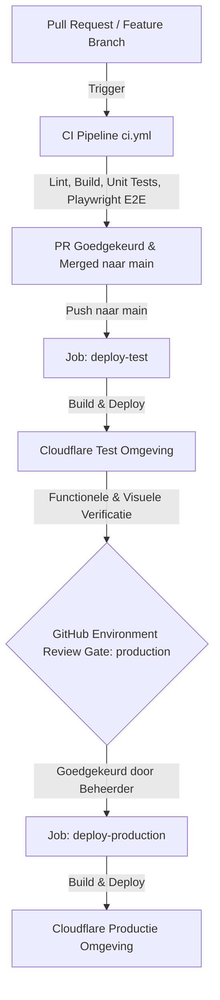

# Deployment Strategie & GitHub Environments

Dit document beschrijft de ontwikkelstraat, release-policy en de inrichting van GitHub Environments voor **Hiking Companion**.

---

## 1. Ontwikkelstraat & Release Policy

Om te waarborgen dat de productieomgeving te allen tijde stabiel is en alle wijzigingen eerst grondig getest kunnen worden, hanteren we een tweetraps-releasebeleid:

1. **Pull Request Validatie**: Iedere wijziging moet eerst via een Pull Request worden aangeboden. De CI workflow (`ci.yml`) voert geautomatiseerd alle eenheidstests en Playwright E2E tests (Desktop, iPhone, Pixel) uit.
2. **On-demand Feature Branch Test Deployment**: Ontwikkelaars kunnen voor iedere actieve `feat/*` branch een directe uitrol naar de test-omgeving (`hiking-companion-test.pages.dev`) triggeren via GitHub Actions `workflow_dispatch` (target: `test`).
3. **Automatische Deploy naar Test**: Na merge van een Pull Request naar de `main` branch bouwt GitHub Actions de monorepo en deployt direct naar de Cloudflare Test-omgeving (`deploy-test`).
4. **Verificatie & Quality Gate**: Ontwikkelaars en testers verifiëren de wijzigingen op de test-URL.
5. **Beheerdersgoedkeuring (Production Gate)**: De `deploy-production` job is gekoppeld aan de GitHub Environment `production`. Deze job start pas nadat een beheerder in de GitHub Actions UI op **Review deployments** -> **Approve and deploy** heeft geklikt.

---

## 2. GitHub Environments Configureren

Ga in je GitHub repository naar **Settings** -> **Environments**:

### A. Environment `test`
1. Klik op **New environment** en voer de naam in: `test`.
2. **Environment protection rules**: Geen vereiste reviewers (mag direct automatisch uitrollen bij merges op `main`).
3. **Deployment branches**: Stel in op `Selected branches` -> `main`.
4. **Environment secrets**:
   - `CLOUDFLARE_API_TOKEN`: De in Cloudflare aangemaakte API Token.
   - `CLOUDFLARE_ACCOUNT_ID`: Jouw Cloudflare Account ID.

### B. Environment `production`
1. Klik op **New environment** en voer de naam in: `production`.
2. **Environment protection rules**:
   - Vink **Required reviewers** aan.
   - Voeg jezelf (of teamleden met beheerderstoegang) toe als reviewers.
   - *(Optioneel)*: Stel een **Wait timer** in (bijv. 5 minuten) als afkoelperiode.
3. **Deployment branches**: Stel in op `Selected branches` -> `main`.
4. **Environment secrets**:
   - `CLOUDFLARE_API_TOKEN`: De Cloudflare API Token.
   - `CLOUDFLARE_ACCOUNT_ID`: Jouw Cloudflare Account ID.

---

## 3. Branch Protection Policy voor `main`

Om te voorkomen dat ongecontroleerde code direct op de test- of productieomgeving belandt:

1. Ga in GitHub naar **Settings** -> **Branches** -> **Add branch protection rule**.
2. **Branch name pattern**: `main`.
3. Vink de volgende regels aan:
   - **Require a pull request before merging**: Minimaal 1 reviewer approval.
   - **Require status checks to pass before merging**:
     - Vink **Require branches to be up to date before merging** aan.
     - Selecteer de CI checks: `Build & Test (Unit & E2E)` uit `ci.yml`.
   - **Do not allow bypassing the above settings**: Zorgt ervoor dat ook administrators door de checks moeten.
