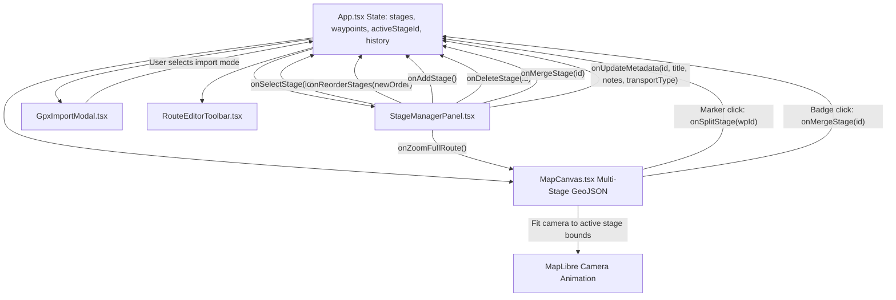

## Context

In `@hiking-companion/core`, `HikeRoute` models `stages: HikeStage[]`, but the current planner editor (`App.tsx`, `RouteEditorToolbar.tsx`, `MapCanvas.tsx`) treats the entire active route as a single flat list of waypoints and wraps the polyline into a single `stage-1`.

This design document specifies the architecture for multi-stage route authoring, public transport (OV) connections, interactive stage splitting, merging, reordering, deletion with point cleanup, GPX import/export parity, and dual camera views (focused stage zoom vs. full-route reset).

## Goals / Non-Goals

**Goals:**
- Provide complete multi-stage authoring: splitting an existing route at any waypoint, adding subsequent stages (`+ Nieuwe etappe`), merging adjacent stages, deleting a stage (with coordinate cleanup and automatic renumbering), and reordering stages via drag-and-drop and step buttons (▲ / ▼).
- Support Public Transport (OV) legs: mark stages as `foot`, `bus`, `train`, or `ferry`, styled on the map with dashed lines and transit badges, with distance metrics separating walking from transit km.
- Provide interactive GPX import choices: append to active stage vs. create new stage, and single-stage merge vs. multi-stage import for multi-track GPX files.
- Export multi-stage routes to standard GPX 1.1 with individual `<trk>` / `<trkseg>` elements containing stage titles, notes, and metrics.
- Maintain separate geometry and metrics per stage (distance, ascent/descent, points) while aggregating overall route statistics.
- Render multi-stage routes on MapLibre with distinctive color palettes per stage, full-contrast active stage highlight, contextual visibility for all other stages, and clear boundary badges (`S1`, `F1 / S2`, `F_last`).
- Provide dual camera navigation: clicking a stage zooms in (`fitBounds`) to that stage, and a `🔍 Toon hele route` button instantly zooms out to frame the entire multi-day trail.

**Non-Goals:**
- External live transit timetable APIs (e.g. 9292 or NS API integration). Transit legs are user-designated schematic connections.
- Per-stage elevation profile splitting (the elevation profile displays the complete route with vertical stage separator lines and highlights the active stage).

## Decisions

### 1. Stage-Aware Data Structure & Type Extensions
- **Decision**: In `packages/core/src/types/index.ts`, extend `HikeStage`:
  ```typescript
  export type TransportType = 'foot' | 'bus' | 'train' | 'ferry';

  export interface HikeStage {
    id: string;
    stageNumber: number;
    title: string;
    distanceKm: number;
    coordinates: Coordinate[];
    notes?: string;
    transportType?: TransportType;
    elevationGainMeters?: number;
    elevationLossMeters?: number;
  }
  ```
  In `packages/core/src/types/route-planner.ts`:
  ```typescript
  export interface RouteWaypoint {
    id: string;
    coordinate: Coordinate;
    routingMode: RoutingMode;
    name?: string;
    stageId?: string;
  }
  ```
- **Rationale**: Keeps waypoints tied to stages while allowing deterministic routing per stage. `transportType` and `notes` are first-class attributes persisted to Cloudflare D1 and exported to GPX.

### 2. Public Transport (OV) Modeling & Visual Styling
- **Decision**: When an etappe is set to `bus`, `train`, or `ferry`:
  - Polyline is rendered with a dashed/dotted pattern (`line-dasharray: [2, 2]`) in MapLibre.
  - The transition badge displays a vehicle icon (🚌, 🚆, ⛴️).
  - Overall route statistics separate walking distance from public transit distance.
- **Rationale**: Hikers immediately see which parts of their itinerary are traversed on foot vs. by vehicle, avoiding misleading multi-day walking statistics.

### 3. Interactive GPX Import Dialogs
- **Decision**: When importing a GPX file:
  - If a route is already active: Show a modal dialog offering:
    1. *"Toevoegen aan huidige etappe"* (Append coordinates to active stage).
    2. *"Als nieuwe etappe toevoegen"* (Spawn a new stage preserving existing stages).
  - If the GPX file contains multiple `<trk>` or `<trkseg>` elements: Show a dialog offering:
    1. *"Als losse etappes importeren"* (Parse each segment into a separate `HikeStage`).
    2. *"Als één samengevoegde etappe importeren"* (Merge into a single stage).
- **Rationale**: Eliminates guesswork and ensures power-users importing routes like the Pieterpad or GR get exact stage structure without flattening.

### 4. Visual Stage Distinction & Transition Badges on MapLibre
- **Decision**: Render route polylines using a GeoJSON `FeatureCollection` where each stage is a `Feature<LineString>`:
  - Palette: Forest Green (`#24583d`), Ochre (`#c26d2e`), Slate Blue (`#33658a`), Purple Sage (`#6b4c7a`), Dark Pine (`#1d3557`).
  - Active stage: line-width `6px`, opacity `1.0`, interactive handles.
  - Inactive stages: line-width `4px`, opacity `0.55` (always visible for global context).
  - Badges: HTML Marker elements on start/transition points:
    - First point: `S1` (Forest Green pill badge)
    - Transition points: `F1 / S2` (Two-tone pill badge)
    - Final finish: `Fn` (Ochre/Pine pill badge)
    - Transit legs: include transit icon (`🚌 S2`).
- **Rationale**: Clear visual hierarchy at a glance, matching physical trail signage.

### 5. Interactive Splitting, Merging, and Deletion
- **Splitting**: Clicking an intermediate waypoint marker shows popup button `"✂️ Splits in nieuwe etappe"`. Waypoints $[0 \dots k]$ remain in Stage $N$, and $[k \dots end]$ move to newly created Stage $N+1$.
- **Merging**: Clicking on a transition badge (`F1 / S2`) or clicking "Samenvoegen" in the sidebar merges Stage $N+1$ into Stage $N$.
- **Deletion**: Clicking "Verwijderen" on a stage prompts for confirmation. Upon confirmation, all waypoints and segments belonging to that stage are removed from the map. Remaining stages are automatically renumbered (1, 2, 3...) sequentially.
- **Add New Stage**: Clicking `+ Nieuwe etappe` in the sidebar appends a new stage starting at the finish point of the last stage.

### 6. Stage Reordering Engine (Drag-and-Drop + Step Buttons)
- **Decision**: In `StageManagerPanel`, support both:
  - HTML5 / pointer drag handles (grip icon) to drag stage cards up and down.
  - Accessible ▲ / ▼ step buttons for mobile touch devices.
  - Moving a stage re-indexes `stageNumber` across all stages and preserves waypoint continuity.

### 7. Dual Camera Navigation
- **Stage Focus**: Clicking a stage card sets `activeStageId` and calls `map.fitBounds(stageBounds, { padding: 80, duration: 800 })`.
- **Full Route Reset**: Dedicated button `🔍 Toon hele route` at the top of the sidebar list calls `fitRouteBounds()` for the entire trail bounding box.

## Architectural Diagram



## Risks / Trade-offs

- **[Risk] Disjoint / Non-contiguous stages (transit gaps)** → *Mitigation*: Support stages whose start coordinate is not identical to the prior stage's finish (e.g. after a bus trip). MapCanvas renders each stage as an independent LineString feature.
- **[Risk] Undo/Redo across stage mutations** → *Mitigation*: Store full snapshots of `{ waypoints, stages, activeStageId }` in the undo/redo stack so undo restores both stage boundaries and geometry seamlessly.
- **[Risk] Touch usability for reordering** → *Mitigation*: Provide both drag-and-drop handles and explicit ▲ / ▼ buttons so mobile/tablet users have zero friction.
