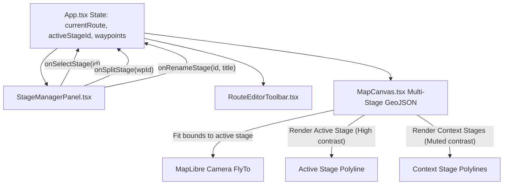

## Context

In `@hiking-companion/core`, `HikeRoute` is already modeled with `stages: HikeStage[]`, and `HikeStage` contains `id`, `stageNumber`, `title`, `distanceKm`, and `coordinates: Coordinate[]`. However, the current planner editor (`App.tsx` and `RouteEditorToolbar.tsx`) treats the entire active route as a single flat list of waypoints and always wraps the computed polyline into a single `stage-1`. 

See `proposal.md` for motivation and user needs.

## Goals / Non-Goals

**Goals:**
- Provide full multi-stage authoring: splitting an existing route into multiple stages at any waypoint, adding subsequent stages, and reordering/renaming stages.
- Maintain separate geometry and metrics per stage (distance in km, ascent/descent, waypoint count) while aggregating overall route statistics.
- Render multi-stage routes on MapLibre with distinctive color palettes per stage, full-contrast active stage highlighting, and contextual visibility for all other stages.
- Synchronize stage list selection in the sidebar with automatic map camera animation (`fitBounds`/`flyTo`) to the selected stage.
- Scope interactive waypoint editing to the active stage while keeping the remaining stages rendered in the background.

**Non-Goals:**
- Multi-day accommodation and campsite booking integrations.
- Elevation profile chart tab switching per stage (the main elevation profile will show the full trail with stage vertical separator lines).

## Decisions

### 1. Stage-Aware Waypoint Data Structure
- **Decision**: In `apps/web/src/App.tsx`, each `RouteWaypoint` will include an optional `stageId?: string`. In addition, an ordered `stages: RouteStageDefinition[]` state (`id`, `stageNumber`, `title`) tracks the stages.
- **Rationale**: When waypoints are split or dragged, assigning `stageId` to waypoints keeps waypoint ordering deterministic. When the route polyline is recalculated via `/api/routing/route`, segments are grouped by `stageId` to produce separate `HikeStage` objects with their own coordinates and distances.
- **Alternatives considered**:
  - *Separate independent waypoint arrays per stage*: Makes route-wide GPX export, undo/redo history, and boundary snapping significantly more complex.

### 2. Multi-Stage Polyline Styling on MapLibre
- **Decision**: Render route polylines using a single GeoJSON `FeatureCollection` where each stage is a `Feature<LineString>` containing `{ stageId, stageNumber, color, isActive }` properties.
- **Palette**: Cycle through an outdoor palette:
  - Stage 1: Emerald/Forest Green (`#24583d`)
  - Stage 2: Deep Ochre / Terracotta (`#c26d2e`)
  - Stage 3: Slate Mountain Blue (`#33658a`)
  - Stage 4: Purple Sage (`#6b4c7a`)
  - Stage 5: Dark Pine (`#1d3557`)
- **Active vs. Inactive**:
  - Active stage: line-width `6px`, opacity `1.0`, casing `2px white`.
  - Inactive stages: line-width `4px`, opacity `0.55`, dashed or solid colored line.
- **Rationale**: Keeps all stages clearly visible at all times, fulfilling the user requirement that non-active stages remain visible during editing.

### 3. Stage Navigation & Camera Viewport Animation
- **Decision**: When the user clicks a stage card in the `StageManagerPanel`:
  1. `activeStageId` is set to that stage.
  2. Bounding box `[minLng, minLat, maxLng, maxLat]` is computed from that stage's coordinates.
  3. `map.fitBounds(bounds, { padding: { top: 90, bottom: 90, left: 340, right: 90 }, duration: 1000 })` is invoked.
- **Rationale**: Instantly provides geographic context for that specific day's hike while keeping the planner sidebar unobscured.

### 4. Interactive Stage Splitting & Boundary Management
- **Decision**: When clicking on any intermediate waypoint marker in editing mode, the popup will provide a button: "✂️ Splits in nieuwe etappe" (Split into new stage).
- **Behavior**: All waypoints from index `0` to `k` remain in Stage `S`, and waypoints from `k` onwards are moved to a newly spawned Stage `S+1`.
- **Alternatives considered**:
  - *Modal split dialog with kilometer slider*: Waypoint-based splitting is more precise and intuitive because hikers split stages at towns, shelters, or road crossings.

## Architectural Diagram

## Risks / Trade-offs

- **[Risk] Single-waypoint stages or empty stages during creation** → *Mitigation*: A stage must have at least 1 coordinate; empty stages show an intuitive placeholder prompt "Klik op de kaart om punten toe te voegen aan deze etappe".
- **[Risk] Undo/redo across stage mutations** → *Mitigation*: Store the full snapshot of `{ waypoints, stages, activeStageId }` in the history stack so undo restores both stage boundaries and waypoint geometry.
- **[Risk] Performance with 10+ stages and thousands of coordinates** → *Mitigation*: GeoJSON vector layers on MapLibre utilize WebGL hardware acceleration; updating feature properties (`isActive`) uses MapLibre feature-state or lightweight dataset updates.
